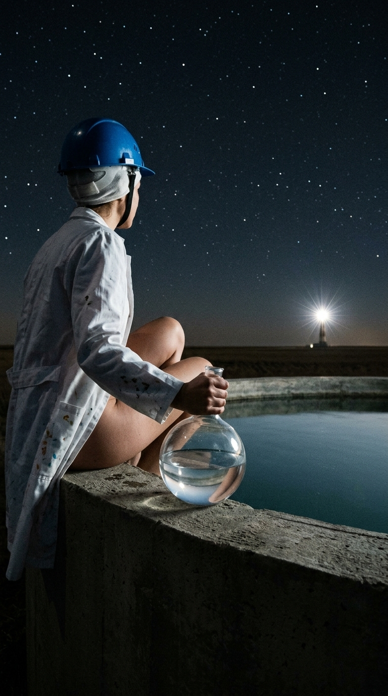
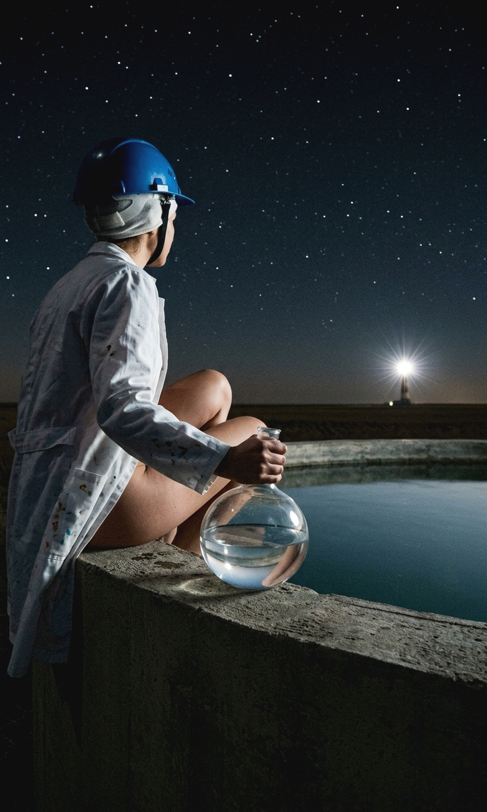

# Photo Shadow-Lift Prepress Toolkit for Print

[Русский](#русский) | [English](#english)

## 🇷🇺 Описание и документация (Russian)

**Photo Shadow-Lift Prepress Toolkit** — это специализированный Python-инструмент авто-препресса для подготовки сложных растровых, фотографических и низкоключевых (low-key) изображений (карты Таро, постеры, артбуки, иллюстрации) к физической цифровой и офсетной печати (The Game Crafter, PrintNinja и др.).

### 🔍 Проблема

При цифровой печати на картоне и бумаге происходят физические процессы **растискивания краски (dot gain)** и компрессии динамического диапазона. Иллюстрации, содержащие индустриальные тени, темные интерьеры, глубокие вертикальные шахты или детали одежды, на физическом отпечатке теряют микроконтраст и схлопываются в неразличимые черные кляксы («подвалы»).

Простая глобальная коррекция (подъем яркости или гаммы) убивает художественную атмосферу: ночное небо становится «молочным», а средние тона выцветают. Линейный аддитивный подъем иногда теряет объем в переходных складках.

### 💡 Решение

Скрипт использует **гибридный метод локальной гаммы в тенях (Local Shadow Gamma Lift)** с пространственной защитой горизонта (неба) и жестоким контролем точки черного. Мидтоны и светлые участки не подвергаются искажению (гамма = 1.0), сохраняя оригинальную плотность, контраст и авторский low-key стиль, в то время как глубокие тени раскрывают скрытые детали и фактуру (под плащом, в складках одежды, на индустриальных кабелях).

### ⚙️ Алгоритм работы (`shadow-lift-prepress.py`)

1. **Гибкая обработка одиночных файлов и папок:**
   Скрипт автоматически определяет тип входного пути — обработать один конкретный файл или весь пакет изображений в директории.

2. **Ресамплинг высокого качества (LANCZOS):**
   Приведение входящих файлов к единому типографскому размеру с высокими стандартами сглаживания.

3. **Умный анализ и пространственная защита (`detect_and_create_protection_mask`):**
   Скрипт анализирует распределение яркости и цветовой баланс (поиск ночного синего неба по каналу `B > R * 1.15`). На основе этого строится мягкая градиентная маска, защищающая небо или свет сверху/снизу от избыточного вытягивания.

4. **Гибридный подъем теней (Локальная гамма в тенях):**
   Вместо искривления всей кривой кадра, математика высчитывает порог теней (10-й перцентиль) и применяет степенную функцию (параметр `-l / --lift`, по умолчанию `0.75`) **исключительно внутри маски теней**.

5. **Локальный микроконтраст и компенсация цвета:**
   Применение фильтра размытия с вычитанием детальности раскрывает скрытые фактуры в тенях, а легкая цветовая компенсация предотвращает «проседание» насыщенности.

6. **Жесткий клэмп точки черного (`--min-black`):**
   Ни один пиксель на выходе не опускается ниже заданного порога (`np.maximum(arr, target_min_black)`, по умолчанию `14` для TGC), предотвращая появление дефектов печати.

## 🖼 Результат работы / Result Showcase

| Исходное изображение (Input) | Результат обработки (Output) | 
| ----- | ----- | 
|  |  | 

## 🚀 Быстрый старт

### Требования

* Python 3.8+
* Зависимости: `Pillow`, `NumPy`, `SciPy`

Установка зависимостей:

```bash
pip install Pillow numpy scipy
```

## 🛠 Использование (CLI)

### 1. Обработка одного файла

Сохранение результата в конкретный PNG-файл:

```bash
python shadow-lift-prepress.py -i input.png -o output.png -s 900x1500 -b 14 -l 0.75
```

Сохранение одного файла в указанную папку:

```bash
python shadow-lift-prepress.py -i input.jpg -o ./output_folder/ -s 900x1500
```

### 2. Пакетная обработка всей папки

```bash
python shadow-lift-prepress.py -i ./cards_raw/ -o ./cards_prepress/ -s 900x1500 -b 14 -l 0.75 -p auto
```

## 📋 Аргументы командной строки

| Аргумент | Флаг | Значение по умолчанию | Описание | 
| ----- | ----- | ----- | ----- | 
| `--input` | `-i` | *Обязательный* | Путь к файлу изображения или к папке с изображениями. | 
| `--output` | `-o` | *Обязательный* | Путь для сохранения (папка или конкретный `.png` файл). | 
| `--size` | `-s` | `900x1500` | Выходной размер в формате `ШИРИНАxВЫСОТА` или `ШИРИНА,ВЫСОТА`. | 
| `--min-black` | `-b` | `14` | Минимальная гарантированная точка черного (защита от заплыва краски). Для TGC: `14`. | 
| `--lift` | `-l` | `0.75` | Гамма локального подъема теней (0.75 по умолч.). Меньше (0.65–0.70) — сильнее вытягивает скрытые детали из черноты, больше (0.80–0.85) — мягче. Мидтоны не затрагивает. | 
| `--protection` | `-p` | `auto` | Зона защиты от вытягивания: `auto` (автоанализ неба/света), `top`, `bottom`, `none`. | 

## 📜 Лицензия / License

Данный проект распространяется под лицензией **MIT License**. Подробности в файле [LICENSE](LICENSE).

## 🇬🇧 English Summary

**Photo Shadow-Lift Prepress Toolkit** is a Python utility designed for pre-press image processing of low-key photos, tarot cards, and illustrations intended for digital and offset printing (The Game Crafter, PrintNinja, etc.).

It solves the **dot gain** problem by using **Local Shadow Gamma Lift** instead of global gamma corrections. Deep shadow textures (under cloaks, in dark folds, and background wires) are intelligently raised above print-crushing thresholds while keeping midtones, highlights, and dark sky atmospheres untouched.

### Features

* **Local Shadow Gamma Lift (`-l / --lift`):** Boosts dark details without making midtones washed out.
* **Smart Spatial Protection (`-p / --protection`):** Automatically detects sky or light direction to avoid over-lifting background gradients.
* **Black Level Clamping (`-b / --min-black`):** Ensures no pixels fall below the printer safety limit (`np.maximum`).
* **Single & Batch Processing:** Supports processing individual image files or whole directories.