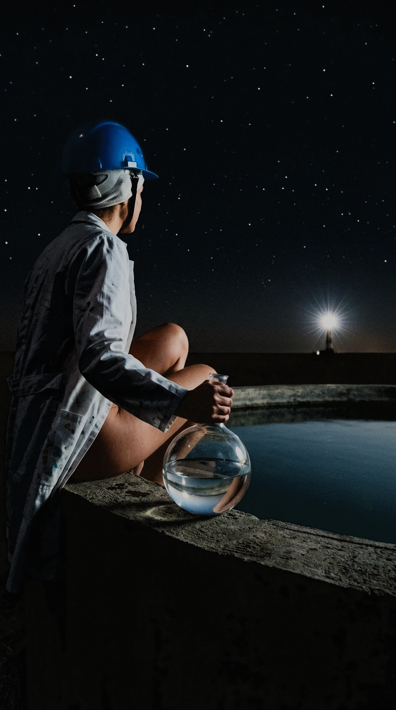
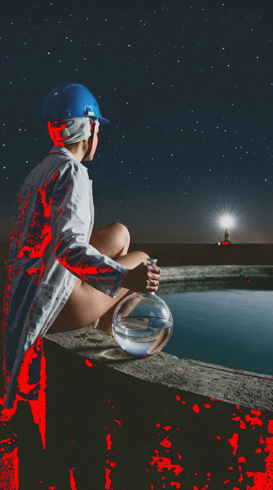

# Photo Shadow-Lift Prepress Toolkit for Print (v1.0.9)

[Русский](#-описание-и-документация-russian) | [English](#-description-and-documentation-english)

---

## 🇷🇺 Photo Shadow-Lift Prepress Toolkit

**Экспериментальный Python-инструмент (v1.0.9) для автоматизированной предпечатной обработки сложных Low-Key изображений, фотографий и художественных работ (карты Таро, постеры, артбуки), предназначенных для цифровой и офсетной печати.**

Инструмент предназначен для подготовки к печати материалов с глубокими тенями. Основное внимание уделяется повышению видимости деталей геометрии в тенях с помощью адаптивной тональной коррекции в пространстве Oklab, пространственно-ориентированной обработки и симуляции поведения типографского оборудования (например, The Game Crafter).

**Статус проекта:** экспериментальный инструмент предпечатной подготовки. Перед запуском тиража каждое обработанное изображение следует проверять индивидуально на физическом пробном отпечатке.

### 🧠 Используемые модели и алгоритмы

Мы отказались от тяжелых нейросетей для теней в пользу детерминированной математики, чтобы обеспечить 100% повторяемость и скорость для 78+ карт.

*   **Модель карты глубины:** **MiDaS_small** (Intel ISL). Используется для извлечения 2.5D карты глубины (кэшируется в `_prepress_maps`). Позволяет разделять передний и задний план, создавая объемный градиент лифтинга.
*   **Модель карты теней:** **ClassicalShadowDetector** (на основе работ Finlayson 2009 / Guo 2013). Детерминистичный алгоритм, анализирующий локальное падение освещенности и хроматический сдвиг. Не требует скачивания весов и работает мгновенно.

### 🔍 Проблема

При цифровой печати на картоне происходят физические процессы **растискивания краски (dot gain)** и компрессии динамического диапазона. Фильтры предпросмотра типографий (как у The Game Crafter) безжалостно отсекают нижние 15-20% яркости в абсолютный черный (`0,0,0`). Из-за этого сложные Low-Key иллюстрации на физическом отпечатке теряют микроконтраст и схлопываются в неразличимые черные кляксы («подвалы»).

### 💡 Решение

Инструмент реализует **интеллектуальный многослойный пайплайн (v1.0.9)**:

1.  **Oklab Color Space:** Работа ведется в перцептивном пространстве, что позволяет поднимать яркость (`L`), не убивая насыщенность цвета (тени остаются цветными, а не серыми).
2.  **Guided Filter & Structure Tensor:** Изображение разделяется на «Базу» и «Детали» с помощью направленного фильтра (без «мыла»). Тензор структуры находит реальную геометрию (трубы, провода, складки), игнорируя цифровой шум.
3.  **Prepress HDR (Filmic Tone Mapping):** Света (пламя, блики) плавно сжимаются к безопасному уровню (`--max-white`), сохраняя градиенты и не выжигая детали.
4.  **TGC Black-Box Simulator:** Скрипт имеет встроенную математическую модель черного фильтра The Game Crafter и режим `--tgc-lift auto`. Он находит зоны, которые типография превратит в черный цвет, и автоматически вытягивает их.

---

### 🖼 Результат работы / Result Showcase

Пример работы движка v1.0.9 (с флагом `--tgc-lift auto`):

| Исходник (Input) | Результат лифтинга (Output) | Симуляция фильтра TGC | Маска Смерти (Crush Mask) |
| :---: | :---: | :---: | :---: |
|  |  |  |  |

*Красная маска (справа) показывает, какие участки фильтр TGC превратит в сплошной черный цвет на бумаге. Алгоритм `--tgc-lift auto` минимизирует эти зоны.*

---

### 🚀 Быстрый старт

#### Требования и зависимости

* Python 3.8+
* PyTorch (для MiDaS)
* OpenCV (для Guided Filter и Structure Tensor)

```bash
pip install Pillow numpy scipy opencv-contrib-python torch torchvision
```
*(Для CUDA-ускорения MiDaS установите PyTorch с поддержкой CUDA согласно официальной инструкции).*

### 🛠 Использование (CLI)

**1. Генерация калибровочных мишеней:**
Позволяет создать тестовые шкалы для загрузки на сайт типографии и проверки их реального отсечения черного.
```bash
python shadow_lift_depth_shadow_prepress.py -o ./probes --generate-probe
```

**2. Пакетная обработка всей колоды с авто-компенсацией TGC:**
```bash
python shadow_lift_depth_shadow_prepress.py -i ./cards_raw/ -o ./cards_prepress/ -s 900x1500 --tgc-lift auto --debug
```

**3. Обработка одиночного файла (с сохранением в конкретный файл):**
```bash
python shadow_lift_depth_shadow_prepress.py -i "C:\raw\card.png" -o "C:\out\final_card.png" --tgc-lift 1.5
```

---

### 📋 Основные аргументы командной строки

| Аргумент | Флаг | По умолчанию | Описание | 
| :--- | :--- | :--- | :--- | 
| `--input` | `-i` | *Обязательный* | Путь к исходному файлу или папке с изображениями. | 
| `--output` | `-o` | *Обязательный* | Путь для сохранения (папка или конкретный `.png` файл). | 
| `--size` | `-s` | `None` | Целевой размер `ШИРИНАxВЫСОТА` (например, `900x1500`). | 
| `--generate-probe`| | `False` | Генерирует калибровочные мишени (`tgc_blackbox_probe.png`, `tgc_highlight_probe.png`) и завершает работу. |
| `--min-black` | `-b` | `14` | Нижняя точка черного. Защита от залипания краски. | 
| `--max-white` | `-w` | `245` | Верхняя точка белого. Защита от выжигания светов на бумаге. | 
| `--tgc-lift` | | `"0.0"` | Компенсация черного фильтра TGC. `auto`, `0.0`, `1.0`, `1.5`. При значении > 0 автоматически поднимает `min_black` до 30 для пробития фильтра TGC. | 
| `--lift-strength`| | `"auto"` | Сила вытягивания теней: `auto` или `0.0–1.0`. | 
| `--detail-boost` | | `1.5` | Усиление HDR-геометрии (труб, проводов) в тенях. `1.0` = выкл. | 
| `--prepress-hdr` | | `1.0` | Сила сжатия светов (Filmic Tone Mapping). `0.0` = выкл. | 
| `--cmyk-compression`| | `0.0` | Защита теней от «грязного» CMYK: `0.0` (выкл) – `1.0` (максимум). | 
| `--debug` | | `False` | Сохраняет отладочные карты (`L`, маски), симуляцию TGC и «Маску Смерти» (Crush Mask). | 

---

## 📜 Лицензия / License

Проект распространяется под лицензией **MIT License**. Подробности смотрите в файле [LICENSE](LICENSE).

---

## ⚠️ Дисклеймер: экспериментальная предпечатная обработка изображений

**Этот проект представляет собой экспериментальный инструментарий. Он не является сертифицированным решением для подготовки файлов к печати.**

Результат зависит от исходного изображения. Экранный предпросмотр и симулятор фильтра TGC не дают окончательной гарантии. Просмотр на экране помогает выявить потенциальные проблемы, но не позволяет полностью предсказать внешний вид физического отпечатка. **Обязательно проверяйте результат на физическом пробном отпечатке до запуска тиража.**

**Используйте инструмент на своё усмотрение.** Автор не гарантирует, что обработанные изображения будут воспроизведены ожидаемым образом на конкретном печатном оборудовании.

---

## 🇬🇧 Photo Shadow-Lift Prepress Toolkit

**An experimental Python toolkit (v1.0.9) for automated prepress processing of complex low-key images, photographs, and artwork (Tarot cards, posters, art books) intended for digital and offset printing.**

The toolkit is designed to prepare print materials with deep shadows. It focuses on improving shadow detail visibility through adaptive tonal correction in the Oklab color space, spatially guided processing, and simulation of printing equipment behavior (e.g., The Game Crafter).

**Project status:** Experimental prepress tool. Processed images should be reviewed individually on physical proofs before final production.

### 🧠 Models and Algorithms Used

We abandoned heavy neural networks for shadows in favor of deterministic mathematics to ensure 100% reproducibility and speed for 78+ cards.

*   **Depth Map Model:** **MiDaS_small** (Intel ISL). Used to extract a 2.5D depth map (cached in `_prepress_maps`). Allows separating the foreground and background, creating a volumetric lifting gradient.
*   **Shadow Map Model:** **ClassicalShadowDetector** (based on Finlayson 2009 / Guo 2013). A deterministic algorithm analyzing local illumination drop and chromatic shift. Requires no weight downloads and runs instantly.

### 🔍 The Problem

During digital printing on cardstock, physical phenomena like **dot gain** and dynamic range compression occur. Print provider preview filters (like TGC) ruthlessly clip the bottom 15-20% of luminance to absolute black (`0,0,0`). As a result, complex Low-Key illustrations lose micro-contrast on the physical print and collapse into unrecognizable flat black patches ("crushed blacks").

### 💡 The Solution

The tool implements a **smart multi-layer pipeline (v1.0.9)**:

1.  **Oklab Color Space:** Processing occurs in a perceptual space, allowing brightness (`L`) to be lifted without killing color saturation (shadows remain colored, not grey).
2.  **Guided Filter & Structure Tensor:** The image is separated into "Base" and "Detail" layers using a guided filter (no blurring). The structure tensor finds actual geometry (pipes, wires, folds), ignoring digital noise.
3.  **Prepress HDR (Filmic Tone Mapping):** Highlights (flames, glare) are smoothly compressed towards a safe level (`--max-white`), preserving gradients without blowing out details.
4.  **TGC Black-Box Simulator:** The script has a built-in mathematical model of The Game Crafter's dark filter and an `--tgc-lift auto` mode. It finds areas that the print shop would turn black and automatically lifts them.

---

### 🖼 Result Showcase

Example of the v1.0.9 engine (with `--tgc-lift auto` flag):

| Input | Lifted Output | Fake TGC Filter | Crush Mask (Doom) |
| :---: | :---: | :---: | :---: |
|  |  |  |  |

*The red mask (right) shows which areas the TGC filter will turn into solid black ink on paper. The `--tgc-lift auto` algorithm minimizes these zones.*

---

### 🚀 Quick Start

#### Requirements

* Python 3.8+
* PyTorch (for MiDaS)
* OpenCV (for Guided Filter and Structure Tensor)

```bash
pip install Pillow numpy scipy opencv-contrib-python torch torchvision
```
*(For CUDA-accelerated MiDaS, install PyTorch with CUDA support per the official guide).*

### 🛠 Usage (CLI)

**1. Generate Calibration Probes:**
Allows you to create test targets to upload to the print provider's website and verify their actual black clipping.
```bash
python shadow_lift_depth_shadow_prepress.py -o ./probes --generate-probe
```

**2. Batch Processing with Auto TGC Compensation:**
```bash
python shadow_lift_depth_shadow_prepress.py -i ./cards_raw/ -o ./cards_prepress/ -s 900x1500 --tgc-lift auto --debug
```

**3. Single File Processing (saving to a specific file):**
```bash
python shadow_lift_depth_shadow_prepress.py -i "C:\raw\card.png" -o "C:\out\final_card.png" --tgc-lift 1.5
```

---

### 📋 CLI Command Parameters

| Parameter | Flag | Default Value | Description | 
| :--- | :--- | :--- | :--- | 
| `--input` | `-i` | *Required* | Path to input image file or folder containing images. | 
| `--output` | `-o` | *Required* | Path for output destination (folder or specific `.png` file). | 
| `--size` | `-s` | `None` | Target dimensions formatted as `WIDTHxHEIGHT` (e.g., `900x1500`). | 
| `--generate-probe`| | `False` | Generates calibration probes (`tgc_blackbox_probe.png`, `tgc_highlight_probe.png`) and exits. |
| `--min-black` | `-b` | `14` | Minimum black point. Prevents ink flooding. | 
| `--max-white` | `-w` | `245` | Maximum white point. Prevents paper blowout. | 
| `--tgc-lift` | | `"0.0"` | TGC dark filter compensation. `auto`, `0.0`, `1.0`, `1.5`. If > 0, automatically raises `min_black` to 30 to punch through the TGC filter. | 
| `--lift-strength`| | `"auto"` | Shadow lift strength: `auto` or `0.0–1.0`. | 
| `--detail-boost` | | `1.5` | HDR geometry boost in shadows (pipes, wires). `1.0` = off. | 
| `--prepress-hdr` | | `1.0` | Highlight compression (Filmic Tone Mapping). `0.0` = off. | 
| `--cmyk-compression`| | `0.0` | Protects shadows from "muddy" CMYK: `0.0` (off) – `1.0` (max). | 
| `--debug` | | `False` | Saves debug maps (L channels, masks), Fake TCG preview, and the Crush Mask. | 

---

## 📜 License

This project is licensed under the **MIT License**. See the [LICENSE](LICENSE) file for full details.

---

## ⚠️ Disclaimer: Experimental Prepress Processing

**This project is an experimental image-preprocessing toolkit. It is not a certified print-preparation solution.**

Results may vary. On-screen previews and the TGC filter simulator help identify potential problems but cannot fully predict the appearance of a physical print. **Always validate the final settings with a physical proof before producing a full batch.**

**Use at your own discretion.** The author makes no guarantee that images processed with this toolkit will achieve any particular visual quality or reproduce as expected on a specific printing system.
