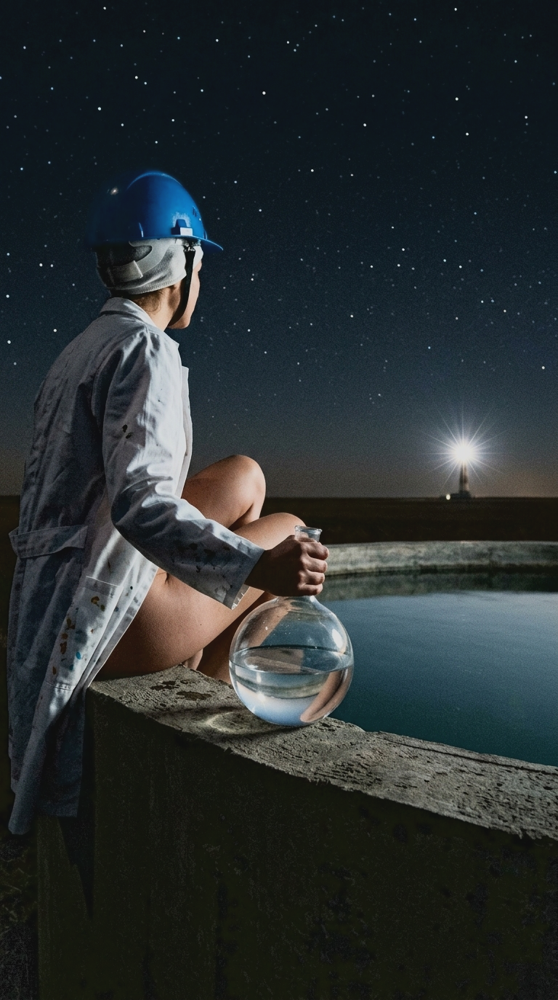
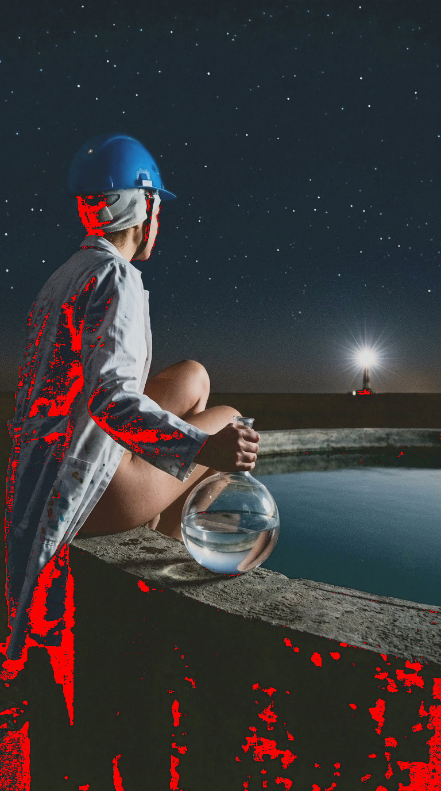

# Photo Shadow-Lift Prepress Toolkit for Print (v1.1.1)

[Русский](#-описание-и-документация-russian) | [English](#-description-and-documentation-english)

---

## 🇷🇺 Photo Shadow-Lift Prepress Toolkit

**Экспериментальный Python-инструмент (v1.1.1) для автоматизированной предпечатной обработки сложных Low-Key изображений, фотографий и художественных работ (карты Таро, постеры, артбуки), предназначенных для цифровой и офсетной печати.**

Инструмент предназначен для подготовки к печати материалов с глубокими тенями. Основное внимание уделяется повышению видимости деталей геометрии в тенях с помощью адаптивной тональной коррекции в пространстве Oklab, пространственно-ориентированной обработки и **двухрежимной симуляции поведения типографского оборудования** (The Game Crafter).

**Статус проекта:** экспериментальный инструмент предпечатной подготовки. Перед запуском тиража каждое обработанное изображение следует проверять индивидуально на физическом пробном отпечатке.

### 🧠 Используемые модели и алгоритмы

Мы отказались от тяжелых нейросетей для теней в пользу детерминированной математики, чтобы обеспечить 100% повторяемость и скорость для 78+ карт.

*   **Модель карты глубины:** **MiDaS_small** (Intel ISL). Используется для извлечения 2.5D карты глубины (кэшируется в `_prepress_maps`). Позволяет разделять передний и задний план, создавая объемный градиент лифтинга.
*   **Модель карты теней:** **ClassicalShadowDetector** (на основе работ Finlayson 2009 / Guo 2013). Детерминистичный алгоритм, анализирующий локальное падение освещенности и хроматический сдвиг.

### 🔍 Проблема

При цифровой печати на картоне происходят физические процессы **растискивания краски (dot gain)** и компрессии динамического диапазона. Фильтры предпросмотра типографий (как у The Game Crafter) безжалостно отсекают нижние 15-20% яркости в абсолютный черный (`0,0,0`). Из-за этого сложные Low-Key иллюстрации на физическом отпечатке теряют микроконтраст и схлопываются в неразличимые черные кляксы («подвалы»).

### 💡 Решение (v1.1.1)

Инструмент реализует **интеллектуальный многослойный пайплайн**:

1.  **Oklab Color Space:** Работа ведется в перцептивном пространстве, что позволяет поднимать яркость (`L`), не убивая насыщенность цвета (Colored Black).
2.  **Guided Filter & Structure Tensor:** Изображение разделяется на «Базу» и «Детали» с помощью направленного фильтра (без «мыла»). Тензор структуры находит реальную геометрию (трубы, провода, складки), игнорируя цифровой шум.
3.  **Защита градиентов (Structural Preservation):** Новая логика сглаживает дефицит яркости (`deficit_smoothed`) в плоских зонах и защищает цветные объекты. Это предотвращает превращение темных углов (например, стен бункера) в размытые пятна.
4.  **Двухрежимный симулятор TGC (`--tgc-lift`):**
    *   **`safe` (По умолчанию):** Безопасный цветовой профиль. Сохраняет 100% оригинальной яркости и глубоких теней, не разрушая Low-Key атмосферу. Идеален для оценки цвета и композиции.
    *   **`stress`:** Агрессивный стресс-тест. Эмулирует жесткое отсечение черного и гамму принтера (Black Clip). Позволяет выявить «Красную зону смерти» (Red Zone of Death), но может создавать искусственную серую мглу (PS1-fog) в глубокой саже.
    *   **Числовые значения (`0.5`, `1.0`):** Промежуточная сила стресс-теста.

---

### 🖼 Результат работы / Result Showcase

Пример работы движка v1.1.1 (с флагом `--tgc-lift stress --debug`):

| Исходник (Input) | Результат лифтинга (Output) | Симуляция фильтра TGC (Stress) | Маска Смерти (Crush Mask) |
| :---: | :---: | :---: | :---: |
|  |  |  |  |

*Красная маска (справа) показывает, какие участки фильтр TGC превратит в сплошной черный цвет на бумаге при агрессивном стрессе.*

---

### 🚀 Быстрый старт

#### Требования и зависимости

* Python 3.8+
* PyTorch (для MiDaS)
* OpenCV (для Guided Filter и Structure Tensor)

```bash
pip install Pillow numpy scipy opencv-contrib-python torch torchvision
```

### 🛠 Использование (CLI)

**1. Генерация калибровочных мишеней:**
```bash
python shadow_lift_depth_shadow_prepress.py -o ./probes --generate-probe
```

**2. Пакетная обработка (Безопасная оценка цвета):**
```bash
python shadow_lift_depth_shadow_prepress.py -i ./cards_raw/ -o ./cards_prepress/ -s 900x1500 --tgc-lift safe --debug
```

**3. Пакетная обработка (Стресс-тест на отсечение черного):**
```bash
python shadow_lift_depth_shadow_prepress.py -i ./cards_raw/ -o ./cards_stress/ -s 900x1500 --tgc-lift stress --debug
```

---

### 📋 Основные аргументы командной строки

| Аргумент | Флаг | По умолчанию | Описание | 
| :--- | :--- | :--- | :--- | 
| `--input` | `-i` | *Обязательный* | Путь к исходному файлу или папке с изображениями. | 
| `--output` | `-o` | *Обязательный* | Путь для сохранения (папка или конкретный `.png` файл). | 
| `--size` | `-s` | `None` | Целевой размер `ШИРИНАxВЫСОТА` (например, `900x1500`). | 
| `--generate-probe`| | `False` | Генерирует калибровочные мишени (`tgc_blackbox_probe.png`, `tgc_highlight_probe.png`) и завершает работу. |
| `--min-black` | `-b` | `14` | Нижняя точка черного. Защита от залипания краски. | 
| `--max-white` | `-w` | `245` | Верхняя точка белого. Защита от выжигания светов на бумаге. | 
| `--tgc-lift` | | `"safe"` | Режим симулятора TGC: `"safe"` (сохраняет яркость), `"stress"` (агрессивный тест отсечения черного) или число (`0.0–1.5`) для промежуточной силы стресса. |
| `--lift-strength`| | `"auto"` | Сила вытягивания теней: `auto` или `0.0–1.0`. | 
| `--detail-boost` | | `1.5` | Усиление HDR-геометрии (труб, проводов) в тенях. `1.0` = выкл. | 
| `--prepress-hdr` | | `1.0` | Сила сжатия светов (Filmic Tone Mapping). `0.0` = выкл. | 
| `--cmyk-compression`| | `0.0` | Защита теней от «грязного» CMYK: `0.0` (выкл) – `1.0` (максимум). | 
| `--debug` | | `False` | Сохраняет отладочные карты (`L`, маски), симуляцию TGC и «Маску Смерти» (Crush Mask). | 

---

## 📜 Лицензия / License

Проект распространяется под лицензией **MIT License**. Подробности смотрите в файле [LICENSE](LICENSE).

---

## ⚠️ Дисклеймер: экспериментальная предпечатная обработка изображений

**Этот проект представляет собой экспериментальный инструментарий. Он не является сертифицированным решением для подготовки файлов к печати.**

Результат зависит от исходного изображения. Экранный предпросмотр и симулятор фильтра TGC не дают окончательной гарантии. Просмотр на экране помогает выявить потенциальные проблемы, но не позволяет полностью предсказать внешний вид физического отпечатка. **Обязательно проверяйте результат на физическом пробном отпечатке до запуска тиража.**

**Используйте инструмент на своё усмотрение.**

---

## 🇬🇧 Photo Shadow-Lift Prepress Toolkit

**An experimental Python toolkit (v1.1.1) for automated prepress processing of complex low-key images, photographs, and artwork intended for digital and offset printing.**

The toolkit is designed to prepare print materials with deep shadows. It focuses on improving shadow detail visibility through adaptive tonal correction in the Oklab color space, spatially guided processing, and a **dual-mode simulation of printing equipment behavior** (The Game Crafter).

**Project status:** Experimental prepress tool. Processed images should be reviewed individually on physical proofs before final production.

### 🧠 Models and Algorithms Used

We abandoned heavy neural networks for shadows in favor of deterministic mathematics to ensure 100% reproducibility and speed for 78+ cards.

*   **Depth Map Model:** **MiDaS_small** (Intel ISL). Used to extract a 2.5D depth map (cached in `_prepress_maps`). Allows separating the foreground and background, creating a volumetric lifting gradient.
*   **Shadow Map Model:** **ClassicalShadowDetector** (based on Finlayson 2009 / Guo 2013). A deterministic algorithm analyzing local illumination drop and chromatic shift.

### 🔍 The Problem

During digital printing on cardstock, physical phenomena like **dot gain** and dynamic range compression occur. Print provider preview filters (like TGC) ruthlessly clip the bottom 15-20% of luminance to absolute black (`0,0,0`). As a result, complex Low-Key illustrations lose micro-contrast on the physical print and collapse into unrecognizable flat black patches ("crushed blacks").

### 💡 The Solution (v1.1.1)

The tool implements a **smart multi-layer pipeline**:

1.  **Oklab Color Space:** Processing occurs in a perceptual space, allowing brightness (`L`) to be lifted without killing color saturation (Colored Black).
2.  **Guided Filter & Structure Tensor:** The image is separated into "Base" and "Detail" layers using a guided filter (no blurring). The structure tensor finds actual geometry, ignoring digital noise.
3.  **Structural Preservation:** New logic smooths the brightness deficit (`deficit_smoothed`) in flat areas and protects colored objects, preventing dark corners (like bunker walls) from turning into blurry blobs.
4.  **Dual-Mode TGC Simulator (`--tgc-lift`):**
    *   **`safe` (Default):** Pure color profile. Preserves 100% of original luminance and deep blacks without destroying low-key atmosphere. Best for checking overall color and composition.
    *   **`stress`:** Aggressive stress test. Simulates harsh print black crush using power functions and gamma. Perfect for exposing the "Red Zone of Death", but may create artificial PS1-like fog in dense black soot.
    *   **Numeric values (`0.5`, `1.0`):** Custom stress-test strength.

---

### 🖼 Result Showcase

Example of the v1.1.1 engine (with `--tgc-lift stress --debug` flag):

| Input | Lifted Output | Fake TGC Filter (Stress) | Crush Mask (Doom) |
| :---: | :---: | :---: | :---: |
|  |  |  |  |

*The red mask (right) shows which areas the TGC filter will turn into solid black ink under aggressive stress.*

---

### 🚀 Quick Start

#### Requirements

* Python 3.8+
* PyTorch (for MiDaS)
* OpenCV (for Guided Filter and Structure Tensor)

```bash
pip install Pillow numpy scipy opencv-contrib-python torch torchvision
```

### 🛠 Usage (CLI)

**1. Generate Calibration Probes:**
```bash
python shadow_lift_depth_shadow_prepress.py -o ./probes --generate-probe
```

**2. Batch Processing (Safe Color Check):**
```bash
python shadow_lift_depth_shadow_prepress.py -i ./cards_raw/ -o ./cards_prepress/ -s 900x1500 --tgc-lift safe --debug
```

**3. Batch Processing (Black Crush Stress Test):**
```bash
python shadow_lift_depth_shadow_prepress.py -i ./cards_raw/ -o ./cards_stress/ -s 900x1500 --tgc-lift stress --debug
```

---

### 📋 CLI Command Parameters

| Parameter | Flag | Default Value | Description | 
| :--- | :--- | :--- | :--- | 
| `--input` | `-i` | *Required* | Path to input image file or folder containing images. | 
| `--output` | `-o` | *Required* | Path for output destination (folder or specific `.png` file). | 
| `--size` | `-s` | `None` | Target dimensions formatted as `WIDTHxHEIGHT` (e.g., `900x1500`). | 
| `--generate-probe`| | `False` | Generates calibration probes and exits. |
| `--min-black` | `-b` | `14` | Minimum black point. Prevents ink flooding. | 
| `--max-white` | `-w` | `245` | Maximum white point. Prevents paper blowout. | 
| `--tgc-lift` | | `"safe"` | TGC preview simulation mode: `"safe"` (preserves luminance), `"stress"` (aggressive black crush test), or a float (`0.0–1.5`) for custom stress strength. | 
| `--lift-strength`| | `"auto"` | Shadow lift strength: `auto` or `0.0–1.0`. | 
| `--detail-boost` | | `1.5` | HDR geometry boost in shadows. `1.0` = off. | 
| `--prepress-hdr` | | `1.0` | Highlight compression (Filmic Tone Mapping). `0.0` = off. | 
| `--cmyk-compression`| | `0.0` | Protects shadows from "muddy" CMYK: `0.0` (off) – `1.0` (max). | 
| `--debug` | | `False` | Saves debug maps (L channels, masks), Fake TGC preview, and the Crush Mask. | 

---

## 📜 License

This project is licensed under the **MIT License**. See the [LICENSE](LICENSE) file for full details.

---

## ⚠️ Disclaimer: Experimental Prepress Processing

**This project is an experimental image-preprocessing toolkit. It is not a certified print-preparation solution.**

Results may vary. On-screen previews and the TGC filter simulator help identify potential problems but cannot fully predict the appearance of a physical print. **Always validate the final settings with a physical proof before producing a full batch.**

**Use at your own discretion.**