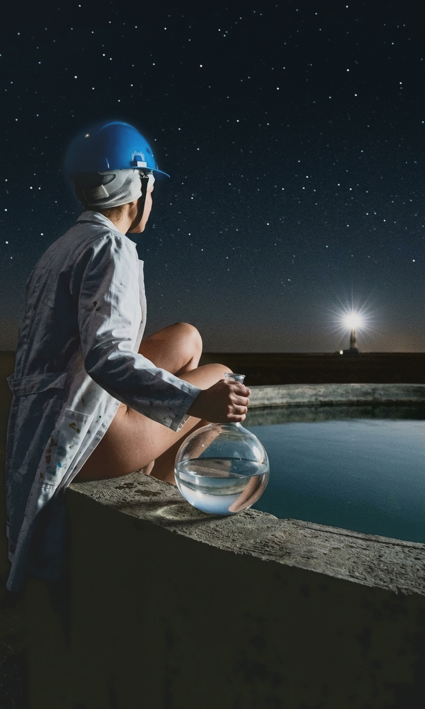

# Photo Shadow-Lift Depth/Shadow Prepress Engine (v1.7.4)

[Русский](#-описание-и-документация-russian) | [English](#-description-and-documentation-english)

---

## 🇷🇺 Shadow-Lift Depth/Shadow Prepress Engine

**Экспериментальный Python-инструмент (v1.7.4 — Intelligent Arcana & Smart-Preserve Edition) для автоматизированной предпечатной подготовки сложных Low-Key изображений, фотографий и художественных работ (карты Таро, постеры, артбуки), предназначенных для цифровой и офсетной печати.**

Инструмент предназначен для подготовки к печати материалов с глубокими тенями. Основное внимание уделяется повышению видимости деталей геометрии в тенях через адаптивную тональную коррекцию в пространстве **Oklab**, пространственно-ориентированную обработку (MiDaS depth, structure tensor, guided filter), семантический анализ темных сцен (**Dark Scene Analyzer**) и **трёхрежимную симуляцию поведения принтера The Game Crafter**.

**Статус проекта:** экспериментальный инструмент предпечатной подготовки. Перед запуском тиража каждое обработанное изображение следует проверять индивидуально на физическом пробном отпечатке.

### 📐 Структура проекта

| Файл / Папка | Назначение | Зависимости |
|---|---|---|
| `shadow_lift_prepress.py` | Основной движок препресса v1.7.4 | torch, cv2, scipy, PIL, numpy |
| `dark_scene/` | Семантический модуль детекции темных сцен (`--smart-preserve`) | cv2, scipy, numpy |
| `dark_scene/darkness_intent.py` | Анализатор намерений региона (Sky Prior & Spatial Awareness) | numpy |
| `dark_scene/mask_generator.py` | Генератор мягких непрерывных масок защищаемых зон | cv2, scipy, numpy |
| `check_models.py` | Инспектор моделей, проверка SHA256 и загрузчик весов MiDaS | только стандартная библиотека |
| `calibrate.py` | Утилита калибровки TGC-фильтра по физическому оттиску | только PIL + numpy |
| `default_curve.json` | Параметры TGC-симулятора (опционально, авто-загружается) | — |
| `generate_showcase.bat` | Скрипт для генерации showcase-изображений для документации | — |
| `requirements.txt` | Зависимости Python | — |

### 🧠 Используемые модели и алгоритмы

Мы отказались от тяжёлых нейросетей для теней в пользу детерминированной математики, чтобы обеспечить 100% повторяемость и скорость для 78+ карт.

*   **Модель карты глубины:** **MiDaS_small** (Intel ISL, `midas_v21_small_256.pt`). Используется для извлечения 2.5D карты глубины (кэшируется в `_prepress_maps` с content-hash по SHA256 файла). Веса **верифицируются по SHA256** при каждом запуске (`70d6b9c8…d56fca`), при несовпадении — prompt / abort / `--accept-models`. Поддерживается локальная папка `./models/` рядом со скриптом. Для автоматической загрузки правильных весов используйте `check_models.py`.
*   **Модель карты теней:** **ClassicalShadowDetector** (Finlayson 2009 / Guo 2013). Детерминистичный алгоритм, анализирующий локальное падение освещённости.
*   **Continuous Auto-Tuner (v1.7.4):** Автономный классификатор сцен. Анализирует непрерывные метрики (гистограмму, smoothness, наличие факелов, ракурс и текстуру), чтобы автоматически подобрать идеальные параметры лифтинга (`--auto`).
*   **Dark Scene Analyzer v2.1 (`--smart-preserve`):** Интеллектуальный анализатор намерений темных сцен.
    *   **Patch 1 (Ground Rescue):** Отвязка `target_map` от `depth_protection` в зонах `RECOVER` (передний план и детали земли восстанавливаются в полном объеме).
    *   **Patch 2 (Smoke Killer):** Жесткий пол TGC и RGB-смещения мягко нейтрализуются в зонах `PRESERVE`, устраняя эффект «серого дыма» и бандинг на физическом оттиске.
*   **TGC-симулятор:** 5-параметровая кривая (`black_clip`, `gamma`, `desat_thresh`, `desat_amount`, `scale_factor`), вынесенная в `default_curve.json`. Только `black_clip` калибруется по физическому оттиску.

### 🔍 Проблема

При цифровой печати на картоне происходят **растискивание краски (dot gain)** и компрессия динамического диапазона. The Game Crafter (TGC) вычитает ~23 RGB (≈9% яркости) из каждой точки, дополнительно применяет гамму и десатурацию теней. Из-за этого Low-Key иллюстрации на физическом отпечатке теряют микроконтраст и схлопываются в сплошные чёрные пятна («подвалы»).

### 💡 Решение (v1.7.4)

Пайплайн реализует **интеллектуальную многослойную коррекцию**:

1.  **Oklab Color Space & Blue-Noise Dithering:** Работа в перцептивном пространстве с использованием сине-шумового дизеринга для предотвращения бандинга в глубоких тенях (усилено в v1.7.4 через `--deband-strength`).
2.  **Guided Filter & Structure Tensor:** Разделение на «Базу» и «Детали» без «мыла». Включает NumPy-fallback для работы без OpenCV-contrib. Исправлен расчет структуры тензора (`Jxy`).
3.  **Auto-Tuner (`--auto`):** Автоматический непрерывный анализ сцены и выбор параметров (от металлов в полутьме до глубоких тоннелей с огнем).
4.  **Smart Preservation (`--smart-preserve`):** Семантический шлюз, предотвращающий подъём фона в глубоких зонах ночной тьмы без появления виниловых стыков и рваных краев.
5.  **TGC Compensation — 3 режима (`--tgc-lift MODE [STRENGTH]`):**
    *   **`off` (default):** Без компенсации.
    *   **`safe`:** Глобальный **hard floor** (`min_black + 16 × strength`, 30 RGB при strength=1.0).
    *   **`stress`:** **Per-pixel floor** с учётом depth, текстуры и семантики Dark Scene. Foreground получает полный floor, ночное небо защищено.
6.  **Soft Floor (`--soft-floor RGB`):** Мягкий (монотонный) floor, заменяющий жёсткий `np.maximum`. Сохраняет градиент в тенях.
7.  **Black Anchor (`--black-anchor FLOAT`):** Точечная защита истинно черных пикселей (Dmax) от подъема.
8.  **QA Sheet (`--qa-dir PATH`):** Генерация наглядных листов для визуальной проверки (4-панельный лист).
9.  **Parallel Processing (`--workers N`):** Многопроцессорная обработка батчей для скорости.
10. **Безопасная обработка абсолютного черного:** Защита от деления на ноль при расчете `lift_ratio`.

---

### 🖼 Результат работы / Result Showcase

Example обработки изображения (слева направо: исходник, --tgc-lift off, --tgc-lift safe, --tgc-lift stress):

| Input Image | --tgc-lift off | --tgc-lift safe | --tgc-lift stress |
| :---: | :---: | :---: | :---: |
|  |  |  |  |

Пример работы движка v1.7.4 в различных режимах (сгенерировано через `generate_showcase.bat`):

| Режим и Параметры | Описание | Результат |
| :--- | :--- | :--- |
| **Auto (No TGC)**<br>`--auto --tgc-lift off` | Чистый sRGB. Вытаскивает детали, но не компенсирует ограничения печати. |  |
| **TGC Safe**<br>`--auto --tgc-lift safe 1.0` | Глобальный жесткий пол. Гарантирует отсутствие черных клякс, но может "убить" атмосферу. |  |
| **TGC Stress (Recommended)**<br>`--auto --smart-preserve --tgc-lift stress 1.0` | Умный пол. Поднимает передний план, защищая дальние планы и небо (Dark Scene Analyzer). |  |
| **Advanced**<br>`--auto --smart-preserve --tgc-lift stress 1.2 --soft-floor 2.5` | Монотонный soft-floor сохраняет градиенты. Генерирует карту рисков. |  |
| **Pro-Tip**<br>`--auto --smart-preserve --tgc-lift stress 1.0 --black-anchor 0.03` | Фиксирует истинный черный (Dmax). Генерирует QA-лист. |  |

---

### 🚀 Быстрый старт

#### Требования и зависимости

```bash
pip install -r requirements.txt
```

> **`calibrate.py` и `check_models.py` не требуют torch/cv2** — только стандартную библиотеку. Их можно запускать на любой машине.

**Загрузка моделей (Опционально, но рекомендуется):**
Если вы хотите заранее скачать веса MiDaS_small и убедиться в их целостности, запустите:
```bash
python check_models.py --download
```
Скрипт скачает модель в папку `./models/`, и основной движок подхватит её автоматически.

### 🛠 Использование (CLI)

**1. Полный автомат (Рекомендуется для новых пользователей):**
```bash
python shadow_lift_prepress.py -i ./cards_raw/ -o ./cards_out/ -s 900x1500 --auto --smart-preserve --tgc-lift stress
```

**2. Базовый препресс (без TGC-компенсации):**
```bash
python shadow_lift_prepress.py -i ./cards_raw/ -o ./cards_prepress/ -s 900x1500 --tgc-lift off
```

**3. Гарантия печати (Safe) + мягкий пол:**
```bash
python shadow_lift_prepress.py -i ./cards_raw/ -o ./cards_safe/ -s 900x1500 --tgc-lift safe --soft-floor 2
```

**4. Prepress filter для типографа (симуляция + risk overlay):**
```bash
python shadow_lift_prepress.py -i ./cards_raw/ -o ./cards_safe/ -s 900x1500 --tgc-lift stress --prepress-filter
```

**5. Пакетная обработка (в 4 потока):**
```bash
python shadow_lift_prepress.py -i ./cards_raw/ -o ./cards_out/ -s 900x1500 --auto --smart-preserve --workers 4
```

---

### ⚠️ КРИТИЧЕСКОЕ ПРЕДУПРЕЖДЕНИЕ: Параметр `--cmyk-compression` и "Двойная коррекция"

В скрипте существует параметр `--cmyk-compression`. Изначально он задумывался как **безопасный инструмент предпросмотра (Preview)**. Его задача — грубо имитировать на экране монитора, как насыщенные цвета и глубокие тени "схлопнутся" при печати CMYK.

**Однако для новичков этот параметр может стать ловушкой!**

#### Сценарий катастрофы (Double Gamut Mapping)
1. **Дизайнер** за монитором запускает скрипт с `--cmyk-compression 0.5`, видит красивый, сбалансированный результат, сохраняет его в RGB (PNG) и отправляет в техотдел.
2. **Техотдел предпечатной подготовки** (или типография, например TGC) получает этот RGB-файл и, согласно своему рабочему процессу, конвертирует его в реальный печатный профиль (например, `GRACoL2006.icc`).
3. **Результат:** Происходит **двойное сжатие цветового охвата**. Скрипт уже искусственно "убил" хрому в тенях (чтобы показать превью), а реальный ICC-профиль типографии "добивает" её окончательно. На бумаге получаются грязные, проваленные тени, теряются детали золота и металлов.

#### Как правильно использовать?
* ✅ **Для превью:** Используйте `--cmyk-compression` только для генерации файлов с суффиксом `_CMYK_PREVIEW.png`. Показывайте их клиенту.
* 🚫 **Для финального экспорта:** Всегда оставляйте `--cmyk-compression 0.0` (значение по умолчанию).
* 📦 **Для типографии:** Отдавайте чистый sRGB-файл (полученный с `0.0`). Если типография требует применения их ICC-профиля (как TGC), применяйте его **самым последним шагом** (через XnConvert, Photoshop или RIP печатной машины), уже после того, как скрипт завершил работу.

*(Примечание: если вы используете `--cmyk-compression` больше нуля, скрипт автоматически добавит к имени файла суффикс `_CMYK_PREVIEW`, чтобы защитить вас от случайной отправки превью в печать).*

---

### 📋 Основные аргументы командной строки

| Аргумент | Флаг | По умолчанию | Описание |
| :--- | :--- | :--- | :--- |
| `--input` | `-i` | *Обязательный* | Путь к исходному файлу или папке. |
| `--output` | `-o` | *Обязательный* | Путь для сохранения. |
| `--size` | `-s` | `None` | Целевой размер `ШИРИНАxВЫСОТА`. |
| `--auto` | | `False` | **v1.7.4.** Авто-анализ сцены и выбор параметров. Переопределяет ручные настройки. |
| `--smart-preserve` | | `False` | **v1.7.4.** Семантический защитник Dark Scene (пространственный Sky Prior, предотвращение швов и дыма). |
| `--tgc-lift` | | `off` | `MODE [STRENGTH]` — `off` / `safe` / `stress`. |
| `--soft-floor` | | `0.0` | Мягкий монотонный floor (0–20 RGB). Только с `safe`/`stress`. |
| `--black-anchor` | | `0.0` | Защита Dmax (истинно черного). 0.02-0.05 - хороший старт. |
| `--deband-strength` | | `auto` | **v1.7.4.** Сила дизеринга и устранения бандинга (0.0–2.0). |
| `--qa-dir` | | `None` | Папка для генерации наглядных "QA-листов" (сравнение исходника, карт глубины/теней и финального результата в одном файле). |
| `--prepress-filter` | | `False` | `*_prepress.png` + `*_prepress_risk.png` + отчет. |
| `--workers` | | `1` | Количество параллельных процессов. |
| `--accept-models` | | `False` | Пропускать запрос подтверждения при расхождении SHA256 весов MiDaS. |
| `--cmyk-compression` | | `0.0` | ⚠️ ТОЛЬКО ПРЕВЬЮ. Эвристическая десатурация теней. |
| `--debug` | | `False` | Отладочные карты для разработчиков. |

---

### 📊 Диагностика

#### Для визуального контроля: `--qa-dir PATH`

Флаг `--qa-dir` создает в указанной папке файлы формата `имя_файла_qa.jpg`. Каждый такой файл — это **«контрольный лист» (contact sheet)**, который склеивается из четырех частей (слева направо):

1. **Исходник:** Как выглядело изображение до обработки.
2. **Карта глубины (Depth):** Как нейросеть MiDaS поняла, что находится близко к зрителю, а что — далеко.
3. **Карта теней (Shadow):** Где алгоритм зафиксировал локальное падение освещенности.
4. **Результат:** Итоговое изображение после лифтинга.

**Зачем это нужно?**
Если финальный результат вас не устроил (например, скрипт поднял небо, но не тронул тоннель), вы открываете этот QA-лист и сразу видите *причину*. Например, по второй картинке (карте глубины) становится понятно: «Ага, нейросеть посчитала, что тоннель — это дальний план, поэтому защитила его от подъема». Это избавляет от слепого перебора настроек.

#### Для типографа: `--prepress-filter`

Сохраняет **два файла**:
- `*_prepress.png` — симуляция печати (stress-модель)
- `*_prepress_risk.png` — красный полупрозрачный overlay на пикселях, где **фильтр съел видимую деталь** (было `lum > 10`, стало `< 8`)

В логе:
```
[PREPRESS] Simulation saved: out/Card_prepress.png
[PREPRESS] Risk overlay saved: out/Card_prepress_risk.png
[PREPRESS] Filter-induced crush: 2,134 px (0.16%) — OK
[PREPRESS] ⚠️ Model NOT calibrated. Verify on physical proof before print.
```

Severity: `OK` (<1 %), `MEDIUM` (1–5 %), `HIGH` (>5 %).

**Красное = фильтр виноват.** Пиксели, которые были тёмными **до** фильтра (`lum ≤ 10`), не красятся — это художественный замысел или вопрос к `--tgc-lift`.

---

## ⚠️ ДИСКЛЕЙМЕР И ОТКАЗ ОТ ОТВЕТСТВЕННОСТИ

**Данный проект представляет собой экспериментальный набор инструментов для предварительной обработки изображений. Он НЕ является сертифицированным решением для подготовки материалов к печати и не дает никаких коммерческих гарантий.**

Результаты могут различаться. Предварительный просмотр на экране и симулятор фильтров TGC не позволяют в полной мере предсказать, как изображение будет выглядеть на физическом отпечатке. **Перед запуском полномасштабной печати обязательно проверяйте итоговые настройки с помощью пробного оттиска.**

**ИСПОЛЬЗУЯ ЭТОТ СКРИПТ, ВЫ ДЕЛАЕТЕ ЭТО ИСКЛЮЧИТЕЛЬНО НА СВОЙ СТРАХ И РИСК.** Автор(ы) не несет ответственности за любой прямой или косвенный ущерб, включая, но не ограничиваясь: испорченные файлы, брак при печати, финансовые потери, упущенную выгоду или любые другие последствия, возникшие в результате использования данного программного обеспечения. **Автор не гарантирует, что скрипт будет работать без ошибок, и не дает никаких гарантий относительно точности цветопередачи.** Если вы не согласны с этими условиями — не используйте этот код.

---

## 🇬🇧 Shadow-Lift Depth/Shadow Prepress Engine

**An experimental Python toolkit (v1.7.4 — Intelligent Arcana & Smart-Preserve Edition) for automated prepress processing of complex low-key images, photographs, and artwork intended for digital and offset printing.**

The toolkit focuses on improving shadow detail visibility through adaptive tonal correction in the Oklab color space, spatially guided processing (MiDaS depth, structure tensor, guided filter), semantic Dark Scene Analysis, and **three-mode simulation of The Game Crafter printer behavior**.

### 📐 Project Structure

| File / Folder | Purpose | Dependencies |
| --- | --- | --- |
| `shadow_lift_prepress.py` | Main prepress engine v1.7.4 | torch, cv2, scipy, PIL, numpy |
| `dark_scene/` | Semantic Dark Scene detection module (`--smart-preserve`) | cv2, scipy, numpy |
| `dark_scene/darkness_intent.py` | Regional Intent Analyzer with Sky Prior & Spatial Awareness | numpy |
| `dark_scene/mask_generator.py` | Continuous soft-mask generator for protected voids | cv2, scipy, numpy |
| `check_models.py` | Model inspector, SHA256 verifier and MiDaS downloader | standard library only |
| `calibrate.py` | TGC simulator curve calibration from physical print | PIL + numpy only |
| `default_curve.json` | TGC simulator parameters (optional, auto-loaded) | — |
| `generate_showcase.bat` | Batch script to generate showcase images for documentation | — |
| `requirements.txt` | Python dependencies | — |

### 🧠 Models and Algorithms Used

*   **Depth Map Model:** **MiDaS_small** (Intel ISL). Weights are **verified by SHA256** on every launch. Supports local `./models/` folder. Use `check_models.py` to download and verify.
*   **Continuous Auto-Tuner (v1.7.4):** Autonomous Scene Classifier. Analyzes continuous metrics (histogram, smoothness, flames, angle, texture) to automatically select ideal parameters (`--auto`).
*   **Dark Scene Analyzer v2.1 (`--smart-preserve`):**
    *   **Patch 1 (Ground Rescue):** Uncouples `target_map` from `depth_protection` in `RECOVER` zones to fully restore foreground elements.
    *   **Patch 2 (Smoke Killer):** Neutralizes TGC hard floor and RGB offsets smoothly within `PRESERVE` zones, eliminating "gray smoke" haze on physical prints.
*   **TGC Simulator:** 5-parameter curve externalized to `default_curve.json`.

---

### 🖼 Result Showcase

Example of image processing (from left to right: input, --tgc-lift off, --tgc-lift safe, --tgc-lift stress):

| Input Image | --tgc-lift off | --tgc-lift safe | --tgc-lift stress |
| :---: | :---: | :---: | :---: |
|  |  |  |  |

*(Note: replace `docs/...` paths with the actual filenames in your repository).*

Example pipeline run (v1.7.4, generated via `generate_showcase.bat`):

| Mode & Parameters | Description | Result |
| :--- | :--- | :--- |
| **Auto (No TGC)**<br>`--auto --tgc-lift off` | Pure sRGB lifting. Reveals details but doesn't compensate for print limits. |  |
| **TGC Safe**<br>`--auto --tgc-lift safe 1.0` | Global hard floor. Guarantees no pixels drop into black. |  |
| **TGC Stress (Recommended)**<br>`--auto --smart-preserve --tgc-lift stress 1.0` | Smart per-pixel floor. Lifts foreground while protecting distant skies (Dark Scene Analyzer). |  |
| **Advanced**<br>`--auto --smart-preserve --tgc-lift stress 1.2 --soft-floor 2.5` | Monotonic soft floor preserves gradient roll-off. Generates risk map. |  |
| **Pro-Tip**<br>`--auto --smart-preserve --tgc-lift stress 1.0 --black-anchor 0.03` | Locks true black (Dmax). Generates side-by-side QA diagnostic sheet. |  |

---

### ⚠️ CRITICAL WARNING: `--cmyk-compression` and "Double Gamut Mapping"

The `--cmyk-compression` parameter was designed exclusively as a **preview tool**. It roughly simulates how colors will collapse during CMYK printing.

**The Trap (Double Gamut Mapping):**
1. A **designer** runs the script with `--cmyk-compression 0.5`, likes the preview, and saves it as a master PNG.
2. The **print shop** receives this RGB file and converts it to their physical ICC profile (e.g., `GRACoL2006.icc`).
3. **Result:** The color gamut is squeezed **twice**. The script already crushed the shadows artificially, and the print shop's ICC profile crushes them again, resulting in muddy, blocked-up shadows.

**How to use it correctly:**
* ✅ **For preview only:** Use `--cmyk-compression` to generate `_CMYK_PREVIEW.png` files for clients.
* 🚫 **For final export:** Always leave it at `0.0` (default).
* 📦 **For the print shop:** Send them a clean sRGB file. Apply their ICC profile as the **very last step** (via XnConvert, Photoshop, or the printer's RIP).

*(Note: If you use `--cmyk-compression > 0`, the script automatically appends `_CMYK_PREVIEW` to the filename to prevent accidental printing).*

---

### 📋 CLI Command Parameters

| Parameter | Flag | Default | Description |
| :--- | :--- | :--- | :--- |
| `--input` | `-i` | *Required* | Path to input file or folder. |
| `--output` | `-o` | *Required* | Path for output (folder or specific `.png`). |
| `--size` | `-s` | `None` | Target size `WIDTHxHEIGHT`. |
| `--auto` | | `False` | **v1.7.4.** Autonomous scene analysis and parameter selection. Overrides manual settings. |
| `--smart-preserve` | | `False` | **v1.7.4.** Semantic Dark Scene defender (spatial Sky Prior, prevents seams and gray smoke). |
| `--tgc-lift` | | `off` | `MODE [STRENGTH]` — `off` / `safe` / `stress`. |
| `--soft-floor` | | `0.0` | Monotonic soft-floor (0–20 RGB). Only with `safe`/`stress`. |
| `--black-anchor` | | `0.0` | Locks true black (Dmax) pixels from lifting. 0.02-0.05 is a good start. |
| `--deband-strength` | | `auto` | **v1.7.4.** Debanding and dithering strength (0.0–2.0). |
| `--qa-dir` | | `None` | Directory to save visual "QA sheets" (side-by-side comparison in a single file). |
| `--prepress-filter` | | `False` | `*_prepress.png` + `*_prepress_risk.png` + severity report. |
| `--workers` | | `1` | Number of parallel processes. |
| `--accept-models` | | `False` | Skip prompt if MiDaS SHA256 differs. |
| `--cmyk-compression` | | `0.0` | ⚠️ PREVIEW ONLY. Heuristic shadow desaturation. |
| `--debug` | | `False` | Developer debug maps. |

---

### 📊 Diagnostics

#### For visual quality control: `--qa-dir PATH`

The `--qa-dir` flag creates `filename_qa.jpg` files in the specified folder. Each file is a **"QA contact sheet"** stitched from four panels (left to right):

1. **Original:** The image before processing.
2. **Depth Map:** How the MiDaS neural network perceived foreground vs. background.
3. **Shadow Map:** Where the algorithm detected local drops in illumination.
4. **Output:** The final lifted image.

**Why is this useful?**
If you are not satisfied with the final result (e.g., the script lifted the sky but ignored the tunnel), you open this QA sheet and immediately see *why*. For example, by looking at the second panel (Depth map), you can see: "Ah, the neural network thought the tunnel was background, so it protected it from being lifted." This saves you from blindly guessing parameter combinations.

#### For the print shop: `--prepress-filter`

Produces **two files**:
- `*_prepress.png` — print simulation (stress model)
- `*_prepress_risk.png` — semi-transparent red overlay on pixels where the **filter ate a visible detail** (was `lum > 10`, became `< 8`)

Log:
```
[PREPRESS] Filter-induced crush: 2,134 px (0.16%) — OK
[PREPRESS] ⚠️ Model NOT calibrated. Verify on physical proof before print.
```

Severity: `OK` (<1 %), `MEDIUM` (1–5 %), `HIGH` (>5 %).

**Red = the filter is the culprit.** Pixels that were already dark **before** filtering (`lum ≤ 10`) are not painted — they are either artistic intent or a `--tgc-lift` concern.

---

## ⚠️ DISCLAIMER AND LIMITATION OF LIABILITY

**This project is an experimental image-preprocessing toolkit. It is NOT a certified print-preparation solution and comes with no commercial guarantees whatsoever.**

Results may vary. On-screen previews and the TGC filter simulator cannot fully predict how an image will look on a physical print. **Always validate final settings with a physical proof before producing a full batch.**

**BY USING THIS SCRIPT, YOU DO SO ENTIRELY AT YOUR OWN RISK.** The author(s) shall not be held liable for any direct or indirect damages, including but not limited to: corrupted files, print spoilage, financial loss, lost profits, or any other consequences arising from the use of this software. **The author makes no warranties that the script will function error-free and provides no guarantees regarding color accuracy.** If you do not agree with these terms, do not use this code.

---

## 📜 License

This project is licensed under the **MIT License**. See [LICENSE](LICENSE).
