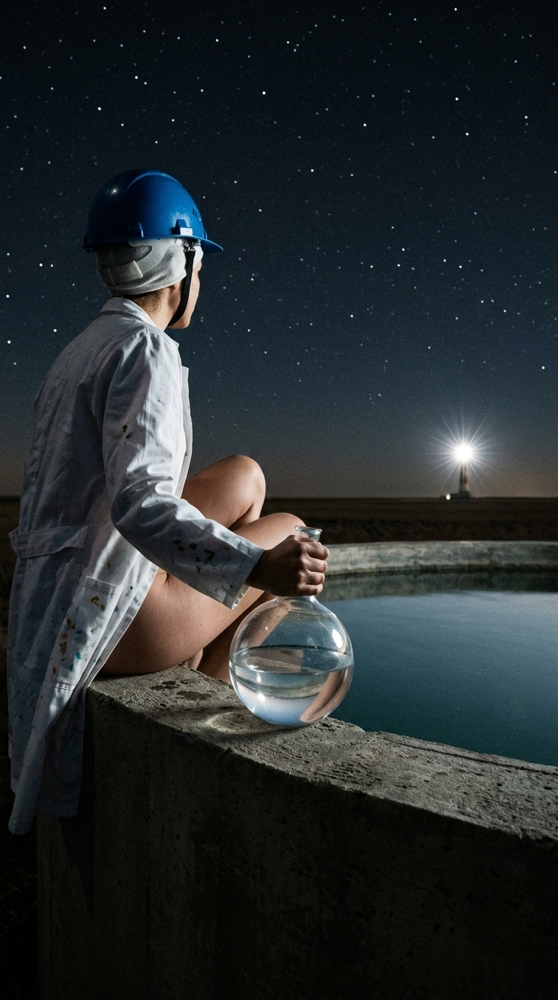
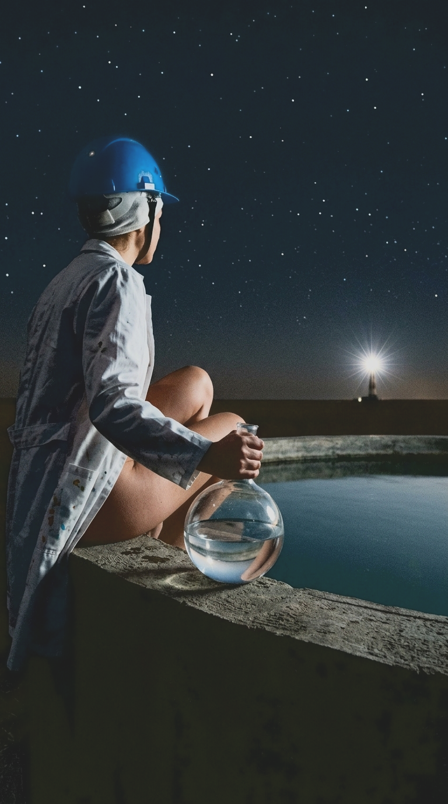

# Photo Shadow-Lift Depth/Shadow Prepress Engine (v1.3.1)

[Русский](#-описание-и-документация-russian) | [English](#-description-and-documentation-english)

---

## 🇷🇺 Shadow-Lift Depth/Shadow Prepress Engine

**Экспериментальный Python-инструмент (v1.3.1) для автоматизированной предпечатной подготовки сложных Low-Key изображений, фотографий и художественных работ (карты Таро, постеры, артбуки), предназначенных для цифровой и офсетной печати.**

Инструмент предназначен для подготовки к печати материалов с глубокими тенями. Основное внимание уделяется повышению видимости деталей геометрии в тенях через адаптивную тональную коррекцию в пространстве **Oklab**, пространственно-ориентированную обработку (MiDaS depth, structure tensor, guided filter) и **трёхрежимную симуляцию поведения принтера The Game Crafter**.

**Статус проекта:** экспериментальный инструмент предпечатной подготовки. Перед запуском тиража каждое обработанное изображение следует проверять индивидуально на физическом пробном отпечатке.

### 🧠 Используемые модели и алгоритмы

Мы отказались от тяжёлых нейросетей для теней в пользу детерминированной математики, чтобы обеспечить 100% повторяемость и скорость для 78+ карт.

*   **Модель карты глубины:** **MiDaS_small** (Intel ISL). Используется для извлечения 2.5D карты глубины (кэшируется в `_prepress_maps` с content-hash по SHA256 файла). Позволяет разделять передний/задний план и строить объёмный градиент лифтинга.
*   **Модель карты теней:** **ClassicalShadowDetector** (Finlayson 2009 / Guo 2013). Детерминистичный алгоритм, анализирующий локальное падение освещённости.
*   **Sky Discriminator (v1.3.1):** Разделяет небо и глубокий тоннель по трём осям — глубина (`depth > 0.7`), абсолютная темнота (`lum < 0.10`) и **плоскость** (`texture_mask ≈ 0`). Тоннель имеет структуру (арки, кирпич), небо — нет. Это устраняет «замыливание» тоннелей и «выбеливание» неба.

### 🔍 Проблема

При цифровой печати на картоне происходят **растискивание краски (dot gain)** и компрессия динамического диапазона. The Game Crafter (TGC) вычитает ~23 RGB (≈9% яркости) из каждой точки, дополнительно применяет гамму и десатурацию теней. Из-за этого Low-Key иллюстрации на физическом отпечатке теряют микроконтраст и схлопываются в сплошные чёрные пятна («подвалы»).

### 💡 Решение (v1.3.1)

Пайплайн реализует **интеллектуальную многослойную коррекцию**:

1.  **Oklab Color Space:** Работа в перцептивном пространстве. Яркость (`L`) поднимается без потери насыщенности (Colored Black).
2.  **Guided Filter & Structure Tensor:** Разделение на «Базу» и «Детали» без «мыла». Тензор структуры находит реальную геометрию (трубы, провода, складки), игнорируя цифровой шум.
3.  **Structural Preservation:** Сглаживание дефицита яркости в плоских зонах, защита цветных объектов. Предотвращает превращение тёмных стен в размытые пятна.
4.  **TGC Compensation — 3 режима (`--tgc-lift MODE [STRENGTH]`):**
    *   **`off` (default):** Без компенсации. Только базовый Oklab-пайплайн. Минимально безопасно для TGC-печати, но тени могут провалиться.
    *   **`safe`:** Глобальный **hard floor** (`np.maximum(L_new, floor_L)`). Floor = `min_black + 16 × strength` (30 RGB при strength=1.0). Гарантирует отсутствие чёрных клякс на всей площади. Небо и света сереют — это цена за безопасность.
    *   **`stress`:** **Per-pixel floor** с учётом depth и текстуры. Foreground (близкое, структурированное) получает полный floor, небо защищено (floor = min_black), тоннели и стены лифтятся до 22–28 RGB. Без «мыла», без «выбеливания».
    *   **`STRENGTH`:** Множитель 0.0–2.0 (default 1.0). Позволяет ослабить или усилить эффект без смены режима.
5.  **Content-hash Cache:** Карты глубины инвалидируются при изменении содержимого файла (SHA256) или версии модели (`midas_small_v1`). Устаревшие кэши больше не используются.

---

### 🖼 Результат работы / Result Showcase

Пример работы движка v1.3.1 (`--tgc-lift stress --debug`):

| Исходник (Input) | Output (без TGC) | Output (Safe, strength 1.0) | Output (Stress, strength 1.0) |
| :---: | :---: | :---: | :---: |
|  |  |  |  |

**Что видно:**
- **Output** — базовый Oklab-пайплайн: сочные тени, читаемая геометрия, но без TGC-компенсации. В `_dbg_TCG_CrushMask.png` будет много красного — честный прогноз.
- **Safe** — глобальный hard floor. Небо становится серым, но CrushMask почти пустая. Гарантия печати ценой атмосферы.
- **Stress** — умный per-pixel floor. Небо тёмное, звёзды читаются, тоннель и foreground вытянуты до безопасного уровня. CrushMask пустая в foreground, красная только на небе (которое и должно быть тёмным).

---

### 🚀 Быстрый старт

#### Требования и зависимости

* Python 3.8+
* PyTorch (для MiDaS)
* OpenCV (для Guided Filter и Structure Tensor)

```bash
pip install Pillow numpy scipy opencv-contrib-python torch torchvision
```

### 🛠 Использование (CLI)

**1. Генерация калибровочных мишеней:**
```bash
python shadow_lift_depth_shadow_prepress.py -o ./probes --generate-probe
```

**2. Базовый препресс (без TGC-компенсации):**
```bash
python shadow_lift_depth_shadow_prepress.py -i ./cards_raw/ -o ./cards_prepress/ -s 900x1500 --tgc-lift off --debug
```

**3. Гарантия печати (Safe, серая цена):**
```bash
python shadow_lift_depth_shadow_prepress.py -i ./cards_raw/ -o ./cards_safe/ -s 900x1500 --tgc-lift safe --debug
```

**4. Умная компенсация (Stress, artistic):**
```bash
python shadow_lift_depth_shadow_prepress.py -i ./cards_raw/ -o ./cards_stress/ -s 900x1500 --tgc-lift stress --debug
```

**5. Мягкая компенсация (Stress 0.7, для светлых сцен):**
```bash
python shadow_lift_depth_shadow_prepress.py -i ./cards_raw/ -o ./cards_soft/ -s 900x1500 --tgc-lift stress 0.7 --debug
```

---

### 📋 Основные аргументы командной строки

| Аргумент | Флаг | По умолчанию | Описание |
| :--- | :--- | :--- | :--- |
| `--input` | `-i` | *Обязательный* | Путь к исходному файлу или папке с изображениями. |
| `--output` | `-o` | *Обязательный* | Путь для сохранения (папка или конкретный `.png` файл). |
| `--size` | `-s` | `None` | Целевой размер `ШИРИНАxВЫСОТА` (например, `900x1500`). |
| `--generate-probe` | | `False` | Генерирует калибровочные мишени (`tgc_blackbox_probe.png`, `tgc_highlight_probe.png`) и завершает работу. |
| `--min-black` | `-b` | `14` | Нижняя точка чёрного. Защита от залипания краски. |
| `--max-white` | `-w` | `245` | Верхняя точка белого. Защита от выжигания светов на бумаге. |
| `--tgc-lift` | | `off` | **Два аргумента: `MODE [STRENGTH]`.**<br>• `off` — без компенсации<br>• `safe` — глобальный hard floor (`min_black + 16×strength`)<br>• `stress` — per-pixel floor по depth и текстуре<br>• `STRENGTH` — 0.0–2.0 (default 1.0). |
| `--lift-strength` | | `"auto"` | Сила вытягивания теней: `auto` или `0.0–1.0`. |
| `--depth-protection` | | `"auto"` | Защита дальнего фона: `auto` (по перцентилям) или `0.0–1.0`. |
| `--detail-boost` | | `1.5` | Усиление HDR-геометрии (труб, проводов) в тенях. `1.0` = выкл. |
| `--prepress-hdr` | | `1.0` | Сжатие светов (Filmic Tone Mapping). `0.0` = выкл. |
| `--cmyk-compression` | | `0.0` | Защита теней от «грязного» CMYK: `0.0` (выкл) – `1.0` (максимум). |
| `--debug` | | `False` | Сохраняет отладочные карты (`L`, маски, `target_map`, `classical_shadow`, `protection_mask`), симуляцию TGC и «Маску Смерти» (Crush Mask). |
| `--no-shadow` | | `False` | Пропустить расчёт карты теней. |
| `--recompute-depth` | | `False` | Принудительно пересчитать карты глубины (игнорировать кэш). |

---

### 📊 Диагностика (`--debug`)

Помимо финального `output.png`, скрипт сохраняет:

- `*_dbg_oklab_L_original.png` — исходная яркость в Oklab
- `*_dbg_oklab_L_lifted.png` — яркость после лифтинга
- `*_dbg_target_map.png` — целевая карта лифтинга
- `*_dbg_classical_shadow.png` — маска локальных теней
- `*_dbg_protection_mask.png` — маска защиты по глубине
- `*_dbg_texture_mask.png` — маска структуры (для sky-дискриминатора)
- `*_fake_TCG_{SAFE|STRESS}.png` — полная симуляция печати
- `*_dbg_TCG_CrushMask_{MODE}.png` — красная маска «зон смерти»
- В логах: `[TGC-SAFE]` или `[TGC-STRESS]` с процентом защищённых/лифтнутых пикселей

**Как читать CrushMask:**
- **Красное небо** — правильно (оно и должно быть тёмным)
- **Красный foreground** — плохо (тени не дотянуты, увеличьте `STRENGTH` или перейдите на `safe`)
- **Всё зелёное** — компенсация работает, файл безопасен для печати

---

### ⚠️ Известные ограничения

- **Гладкий тоннель** (без видимой текстуры): `texture_mask ≈ 0` → может быть классифицирован как небо → не лифтнётся в `stress`. Обход: `--tgc-lift safe` или `--tgc-lift stress 1.5`.
- **Плотная облачность**: `texture_mask > 0.5` → небо может быть классифицировано как foreground → выбелится. Обход: `--tgc-lift off` или `-b 0` с ручной проверкой.
- **MiDaS в замкнутых пространствах** (тоннели, серверные) может давать высокую depth у стен — `foreground_gate` частично компенсируется `flat_sky_gate`.

---

## 📜 Лицензия / License

Проект распространяется под лицензией **MIT License**. Подробности смотрите в файле [LICENSE](LICENSE).

---

## ⚠️ Дисклеймер

**Этот проект представляет собой экспериментальный инструментарий. Он не является сертифицированным решением для подготовки файлов к печати.**

Результат зависит от исходного изображения. Экранный предпросмотр и симулятор фильтра TGC не дают окончательной гарантии. Просмотр на экране помогает выявить потенциальные проблемы, но не позволяет полностью предсказать внешний вид физического отпечатка. **Обязательно проверяйте результат на физическом пробном отпечатке до запуска тиража.**

**Используйте инструмент на своё усмотрение.**

---

## 🇬🇧 Shadow-Lift Depth/Shadow Prepress Engine

**An experimental Python toolkit (v1.3.1) for automated prepress processing of complex low-key images, photographs, and artwork intended for digital and offset printing.**

The toolkit is designed to prepare print materials with deep shadows. It focuses on improving shadow detail visibility through adaptive tonal correction in the Oklab color space, spatially guided processing (MiDaS depth, structure tensor, guided filter), and **three-mode simulation of The Game Crafter printer behavior**.

**Project status:** Experimental prepress tool. Processed images should be reviewed individually on physical proofs before final production.

### 🧠 Models and Algorithms Used

We abandoned heavy neural networks for shadows in favor of deterministic mathematics to ensure 100% reproducibility and speed for 78+ cards.

*   **Depth Map Model:** **MiDaS_small** (Intel ISL). Used to extract a 2.5D depth map (cached in `_prepress_maps` with SHA256 content-hash). Allows separating foreground/background and building a volumetric lifting gradient.
*   **Shadow Map Model:** **ClassicalShadowDetector** (Finlayson 2009 / Guo 2013). Deterministic algorithm analyzing local illumination drop.
*   **Sky Discriminator (v1.3.1):** Separates sky from deep tunnels along three axes — depth (`depth > 0.7`), absolute darkness (`lum < 0.10`), and **flatness** (`texture_mask ≈ 0`). Tunnels have structure (arches, bricks), sky does not. Eliminates both "tunnel blur" and "sky washout".

### 🔍 The Problem

During digital printing on cardstock, physical phenomena like **dot gain** and dynamic range compression occur. The Game Crafter (TGC) subtracts ~23 RGB (~9% luminance) from every pixel, then applies additional gamma and shadow desaturation. As a result, low-key illustrations lose micro-contrast and collapse into flat black patches ("crushed blacks").

### 💡 The Solution (v1.3.1)

The pipeline implements **smart multi-layer correction**:

1.  **Oklab Color Space:** Processing occurs in a perceptual space. Brightness (`L`) is lifted without losing saturation (Colored Black).
2.  **Guided Filter & Structure Tensor:** Splits image into "Base" and "Detail" without blurring. Structure tensor finds real geometry (pipes, wires, folds) while ignoring digital noise.
3.  **Structural Preservation:** Smooths brightness deficit in flat areas and protects colored objects. Prevents dark walls from becoming blurry blobs.
4.  **TGC Compensation — 3 modes (`--tgc-lift MODE [STRENGTH]`):**
    *   **`off` (default):** No compensation. Base Oklab pipeline only. Minimally safe for TGC, but shadows may crush.
    *   **`safe`:** Global **hard floor** (`np.maximum(L_new, floor_L)`). Floor = `min_black + 16 × strength` (30 RGB at strength=1.0). Guarantees no black blobs anywhere. Sky and highlights turn gray — the price of safety.
    *   **`stress`:** **Per-pixel floor** aware of depth and texture. Foreground (near, structured) gets full floor, sky is protected (floor = min_black), tunnels and walls lift to 22–28 RGB. No blur, no washout.
    *   **`STRENGTH`:** Multiplier 0.0–2.0 (default 1.0). Allows weakening or strengthening without changing mode.
5.  **Content-hash Cache:** Depth maps invalidate on file content change (SHA256) or model version (`midas_small_v1`). Stale caches are never used.

---

### 🖼 Result Showcase

Example pipeline run (v1.3.1, `--tgc-lift stress --debug`):

| Input | Output (no TGC) | Output (Safe, strength 1.0) | Output (Stress, strength 1.0) |
| :---: | :---: | :---: | :---: |
|  |  |  |  |

**What you see:**
- **Output** — base Oklab pipeline: rich shadows, readable geometry, no TGC compensation. `_dbg_TCG_CrushMask.png` will show lots of red — honest forecast.
- **Safe** — global hard floor. Sky turns gray, but CrushMask is nearly empty. Print guarantee at the cost of atmosphere.
- **Stress** — smart per-pixel floor. Sky stays dark, stars are crisp, tunnels and foreground lift to safe level. CrushMask empty in foreground, red only in sky (which should be dark).

---

### 🚀 Quick Start

#### Requirements

* Python 3.8+
* PyTorch (for MiDaS)
* OpenCV (for Guided Filter and Structure Tensor)

```bash
pip install Pillow numpy scipy opencv-contrib-python torch torchvision
```

### 🛠 Usage (CLI)

**1. Generate calibration probes:**
```bash
python shadow_lift_depth_shadow_prepress.py -o ./probes --generate-probe
```

**2. Base prepress (no TGC compensation):**
```bash
python shadow_lift_depth_shadow_prepress.py -i ./cards_raw/ -o ./cards_prepress/ -s 900x1500 --tgc-lift off --debug
```

**3. Print guarantee (Safe, gray price):**
```bash
python shadow_lift_depth_shadow_prepress.py -i ./cards_raw/ -o ./cards_safe/ -s 900x1500 --tgc-lift safe --debug
```

**4. Smart compensation (Stress, artistic):**
```bash
python shadow_lift_depth_shadow_prepress.py -i ./cards_raw/ -o ./cards_stress/ -s 900x1500 --tgc-lift stress --debug
```

**5. Soft compensation (Stress 0.7, for light scenes):**
```bash
python shadow_lift_depth_shadow_prepress.py -i ./cards_raw/ -o ./cards_soft/ -s 900x1500 --tgc-lift stress 0.7 --debug
```

---

### 📋 CLI Command Parameters

| Parameter | Flag | Default | Description |
| :--- | :--- | :--- | :--- |
| `--input` | `-i` | *Required* | Path to input file or folder. |
| `--output` | `-o` | *Required* | Path for output (folder or specific `.png` file). |
| `--size` | `-s` | `None` | Target size `WIDTHxHEIGHT` (e.g. `900x1500`). |
| `--generate-probe` | | `False` | Generates calibration probes and exits. |
| `--min-black` | `-b` | `14` | Minimum black point. Prevents ink flooding. |
| `--max-white` | `-w` | `245` | Maximum white point. Prevents paper blowout. |
| `--tgc-lift` | | `off` | **Two args: `MODE [STRENGTH]`.**<br>• `off` — no compensation<br>• `safe` — global hard floor (`min_black + 16×strength`)<br>• `stress` — per-pixel floor via depth + texture<br>• `STRENGTH` — 0.0–2.0 (default 1.0). |
| `--lift-strength` | | `"auto"` | Shadow lift strength: `auto` or `0.0–1.0`. |
| `--depth-protection` | | `"auto"` | Far background protection: `auto` (by percentile) or `0.0–1.0`. |
| `--detail-boost` | | `1.5` | HDR geometry boost in shadows. `1.0` = off. |
| `--prepress-hdr` | | `1.0` | Highlight compression (Filmic Tone Mapping). `0.0` = off. |
| `--cmyk-compression` | | `0.0` | Shadow protection from "muddy" CMYK: `0.0` (off) – `1.0` (max). |
| `--debug` | | `False` | Saves debug maps (`L`, masks, `target_map`, `classical_shadow`, `protection_mask`), Fake TGC preview, and Crush Mask. |
| `--no-shadow` | | `False` | Skip shadow map calculation. |
| `--recompute-depth` | | `False` | Force recompute depth maps (ignore cache). |

---

### 📊 Diagnostics (`--debug`)

Besides the final `output.png`, the script saves:

- `*_dbg_oklab_L_original.png` — original Oklab luminance
- `*_dbg_oklab_L_lifted.png` — luminance after lifting
- `*_dbg_target_map.png` — target lift map
- `*_dbg_classical_shadow.png` — local shadow mask
- `*_dbg_protection_mask.png` — depth protection mask
- `*_dbg_texture_mask.png` — structure mask (for sky discriminator)
- `*_fake_TCG_{SAFE|STRESS}.png` — full print simulation
- `*_dbg_TCG_CrushMask_{MODE}.png` — red "doom zone" mask
- Console: `[TGC-SAFE]` or `[TGC-STRESS]` with protected/lifted pixel percentages

**How to read CrushMask:**
- **Red sky** — correct (it should be dark)
- **Red foreground** — bad (shadows not lifted, increase `STRENGTH` or switch to `safe`)
- **All green** — compensation works, file is print-safe

---

### ⚠️ Known Limitations

- **Smooth tunnel** (no visible texture): `texture_mask ≈ 0` → may be classified as sky → not lifted in `stress`. Workaround: `--tgc-lift safe` or `--tgc-lift stress 1.5`.
- **Heavy overcast**: `texture_mask > 0.5` → sky may be classified as foreground → washout. Workaround: `--tgc-lift off` or `-b 0` with manual review.
- **MiDaS in enclosed spaces** (tunnels, server rooms) may give high depth to walls — `foreground_gate` is partially compensated by `flat_sky_gate`.

---

## 📜 License

This project is licensed under the **MIT License**. See the [LICENSE](LICENSE) file for full details.

---

## ⚠️ Disclaimer

**This project is an experimental image-preprocessing toolkit. It is not a certified print-preparation solution.**

Results may vary. On-screen previews and the TGC filter simulator help identify potential problems but cannot fully predict the appearance of a physical print. **Always validate the final settings with a physical proof before producing a full batch.**

**Use at your own discretion.**